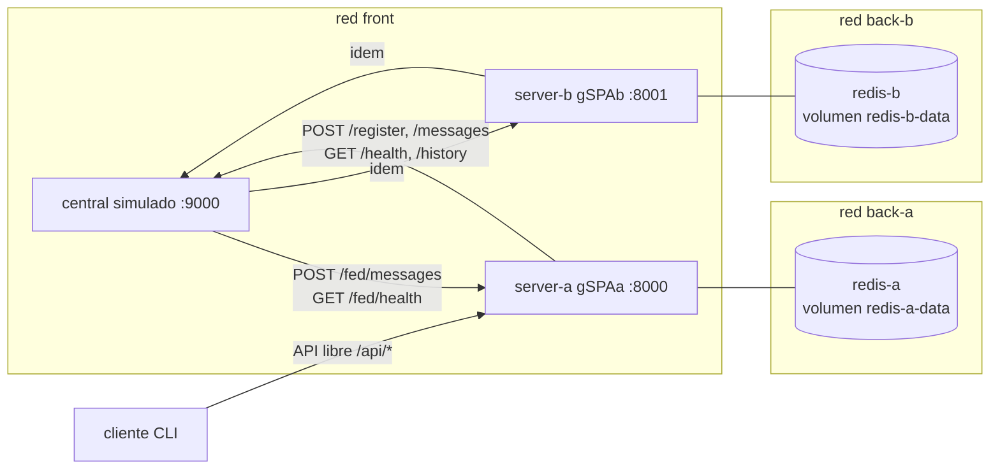

# Arquitectura

## Laboratorio local (`docker-compose.local.yml`)

- **Contenedores:** `central`, `server-a`, `server-b`, `redis-a`, `redis-b` (5).
- **Redes:** `front` (central ↔ servidores) y una red `back-*` por grupo (servidor ↔ su Redis). Separar `front` permite aislar un servidor del central **sin** cortarle el acceso a su Redis (prueba D5).
- **Volúmenes:** `redis-a-data` y `redis-b-data` (AOF `everysec`): conservan usuarios, historial, reloj y outbox.
- Los servidores de grupo **no se hablan entre sí**: todo pasa por el central (topología en estrella).

## Despliegue de un grupo (`docker-compose.yml`)
`server` + `redis` (+ volumen `redis-data`). El central es **externo**: su URL llega por `CENTRAL_URL`; la URL con la que el central nos alcanza, por `PUBLIC_URL`.

## Claves de Redis
`lamport` (reloj), `users`, `messages` (hash id→mensaje: también es la tabla de ids vistos), `history` (zset: puntaje = lamport, miembro `origin\x00id`), `outbox` (zset por instante del próximo intento), `attempts`, `rejected`.

## Hilos del servidor
`supervisor` (heartbeat, registro, recuperación de historial) y `sender` (vacía el outbox con backoff); la API corre en el pool de hilos de FastAPI.
